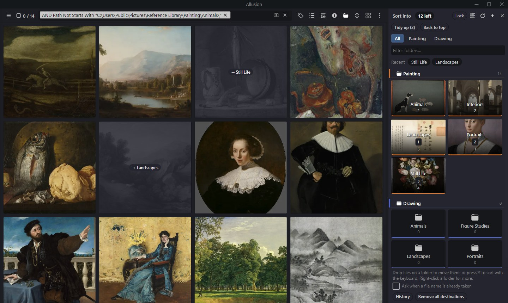
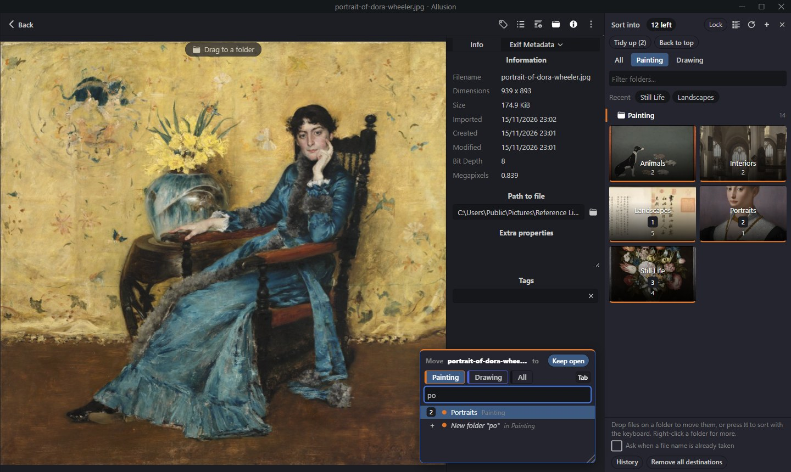

Fork of [Allusion](https://github.com/allusion-app/Allusion/) with:
- Video support.
  - Video and GIF playback options.
- Bulk tagging.
- Implied tag relationships.
  - Automatic inheritance of implied tags.
  - Fully compatible with advanced search.
- Extra Properties.
  - Allows you to define extra properties for files.
  - Sort files by their extra property values.
  - Use those extra properties in advanced searches.
- Quality of life improvements.
  - Refresh hotkey.
  - Fixed weird behavior in the tags tree when dragging/dropping or expanding items.
  - Versatile tag selection in the tags tree using and combining modifier keys.
    - Hold Alt to select whole tag collections (a tag and its sub-tags); otherwise, only select visible tags.
    - Hold Command/Control to enable additive/subtractive selection.
    - Hold Shift to enable selecting multiple items in range.
  - Improved thumbnail updates when files change.
  - Retry thumbnail generation when it takes too long.
  - Tag editor can be moved to the side in the main gallery.
  - Find tags using the contextual menu in the tag editor.
  - Adjustable padding for thumbnails in the gallery.
  - Multiple optimizations and bug fixes.
  - And more, see the changelogs in the releases page for more details.
        
## Sorting by moving files

This version adds a workflow for people who organise their library in **folders** rather than with tags. You look at an image and put the file into the folder it belongs to, and Allusion keeps track of it.

*An inbox of unsorted references on the left, the folders they are sorted into on the right. Files that were just moved stay in place, greyed out.*

### Why this is useful

Collecting references is quick, sorting them is not. Files pile up in a download or inbox folder, and moving them one by one in a file browser means switching windows, finding the right folder again and again, and hoping nothing gets overwritten on the way. Allusion already shows the images at a size where you can judge them, so this is the natural place to decide where each one goes.

- **Fast:** one drop or one key per image, and the next image is ready straight away.
- **Safe:** files are moved, never silently overwritten, every move can be undone, and an interrupted move is cleaned up at the next start.
- **Still a normal folder structure:** nothing is locked into the app. The result is plain folders on disk that any other program can use.

### Why a separate panel instead of the Locations panel

The Locations panel on the left shows your *whole* library: every location and every folder in it. It is made for browsing. For sorting, that is too much to search through with every single file.

The destination panel shows only what you are sorting into right now. You choose the few folders that matter for this session, for example `Painting` and `Drawing`, and their sub folders become large drop targets. That keeps your attention on the decision ("where does this one go?") instead of on finding a folder in a long tree. It also makes room for things a general folder tree does not need: big tiles with a picture of each folder, colours, a file count per folder, recently used folders, number keys, and a counter of how much is left to sort.

Dragging files onto folders in the Locations panel still works, with the same safeguards.

### What it can do

*Sorting in the full-size view: type a few letters of a folder name, or press a number key.*

- **Safe moves instead of copies.**
  - Files are really moved, and tags and other properties stay with them.
  - Moves to another drive are copied, checked against the original, and only then is the original removed.
  - Existing files are never overwritten. A file whose name is already taken is renamed (`name (1).jpg`) and the notification tells you; optionally you are asked instead.
  - Undo and redo (`Ctrl+Z`, `Ctrl+Shift+Z`), a history of the last moves with undo per entry, and a notification with an Undo button after every move.
  - Long moves show their progress and can be cancelled.
  - If the app is closed in the middle of a move, it tidies up at the next start: no half-copied files, no lost originals.
- **Destination panel** (`D`, or the folder button in the toolbar).
  - Add any number of destination folders. Their sub folders are read from disk and shown as a tree or as large tiles with a picture. A tile with sub folders opens to show those.
  - Drop files on a folder to move them there. Folders open while you hover, unless the panel is locked.
  - Filter folders by name, create and rename folders, and see recently used folders.
  - Give folders a colour (sub folders inherit it) and choose the picture of a folder with "Use as Folder Picture" in the file menu.
  - Each folder shows how many files it holds. A counter shows how many files are not in a category folder yet; click it to see them.
  - Files lying directly in a destination folder ("loose" files) can be shown on their own.
- **Keyboard sorting** (`M`).
  - A small box you can move and resize. Type a few letters of a folder name and press `Enter`.
  - `Tab` switches between your destination folders, so only the folders of one are offered. This is the quick first decision when several destinations have the same sub folders, such as `Painting/Portraits` and `Drawing/Portraits`.
  - Assign the number keys `1`-`9` to folders. With destinations that are organised alike, the same keys work in each of them.
  - The folder you used last is offered first, `Space` skips a file, and the next file is selected after every move.
  - A name that no folder has yet is offered as a new folder: `Ctrl+Enter` creates it and moves the file there.
  - `Del` deletes the file without asking; Undo brings it back before it goes to the recycle bin.
  - `Shift+M` moves to the last used folder without opening the box.
- **Sorting from the full-size view.**
  - Drag the "Drag to a folder" handle onto a folder, or use the keyboard box. The next image is shown after a move, and files that were already moved are skipped.
- **A calm gallery while sorting.**
  - Moved files stay where they are, greyed out and labelled with their new folder, until you press "Tidy up" or the view is reloaded. Nothing jumps around.
- **Open with another program.** "Open External" in the file menu opens the file with the default program; its sub menu lists programs you add yourself, for example an image editor.
- Also: "Move to Folder..." in the file menu (`Ctrl+M`).

The options are in Settings → Sorting, and the hotkeys can be changed in Settings → Shortcuts.

Why this version exists is explained in [issue #1](https://github.com/alpakadev/Allusion/issues/1). This feature was developed with the help of an AI coding assistant.

The pictures in the screenshots are public domain works from the Cleveland Museum of Art, shared under CC0 through its Open Access programme.

Thanks to the developers and the community for your hard work! ❤️

---

Allusion is a tool built for artists, aimed to help you organize your **Visual Library** – A single place that contains your entire collection of references, inspiration and any other kinds of images.

[Read more about Allusion →](https://allusion-app.github.io/)

## Installation

Find the latest version of Allusion on the [Releases](https://github.com/RafaUC/Allusion/releases) page.

## Development

### Quick Start

You need to have [NodeJS](https://nodejs.org/en/download/) and a package manager such as [Yarn](https://yarnpkg.com/lang/en/docs/install/) installed.
Then run the following commands to get started:

1. Run `yarn install` to install or update all necessary dependencies.
2. Run `yarn dev` to build the project files to the `/build` directory. This will keep running to immediately build changed files when they are updated.
3. In a second terminal, run `yarn start` to start the application. Refresh the window (Ctrl/Cmd + R) after modifying a file to load the updated build files.

### Release Build

An installable executable can be built using `yarn package` for your platform in the `/dist` folder. The building is performed using the [electron-builder](https://www.electron.build/) package, and is configured by a section in the `package.json` file.

## Further Information

The original repo had a [wiki] with documentation (https://github.com/allusion-app/Allusion/wiki).
